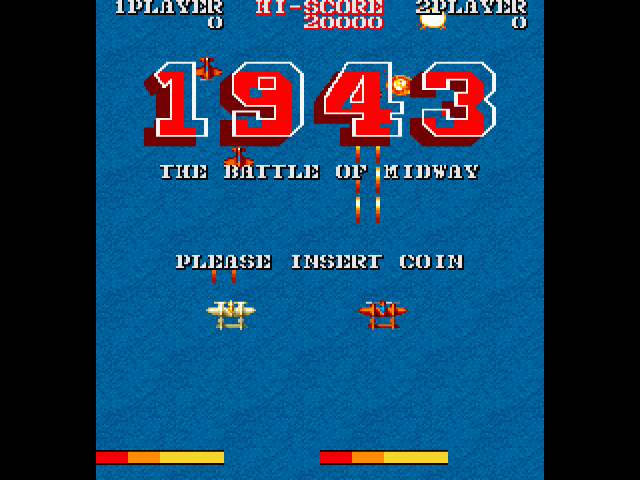
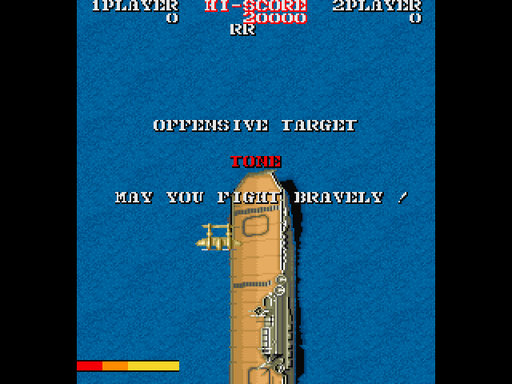
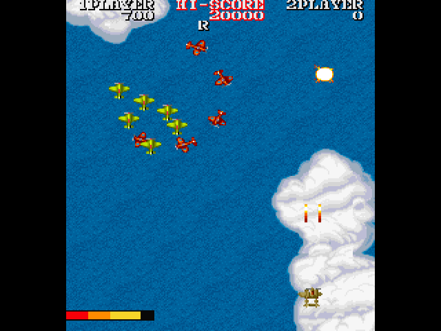
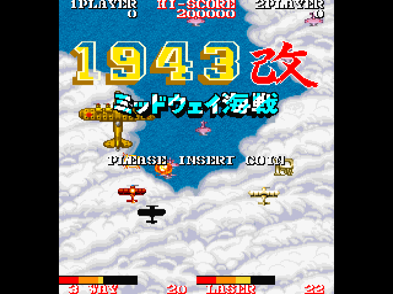
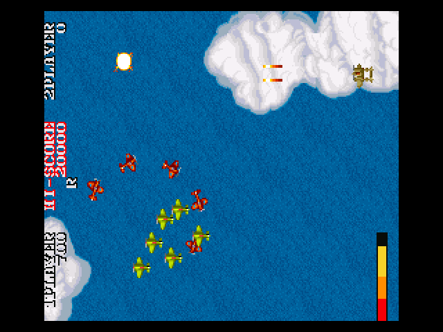
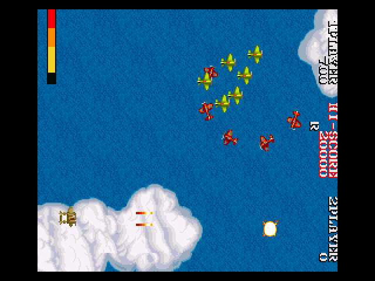

# pico-1943

**pico-1943** is an emulator of the arcade games **1943: The Battle of Midway** and **1943 Kai: Midway Kaisen** (Capcom, 1987) for RP2350-based microcontroller boards, with video and audio over DVI/HDMI. It emulates the original board: the main Z80 CPU with its banked program ROM, the sound Z80 with two Yamaha YM2203 FM sound chips, the two scrolling tile layers, the sprites and the character layer, and the colour PROMs. The i8751 microcontroller that protects the game is replaced by the table of its answers. The emulation is based on the 1943 driver and the Z80 core of [MAME](https://www.mamedev.org/), the YM2203 emulation of MAME's `fm.cpp` and of [ymfm](https://github.com/aaronsgiles/ymfm).

It uses the same menu, display, audio and controller framework as this family of emulators:

- NES: [pico-infonesPlus](https://github.com/PicoPlus-devel/pico-infonesPlus)
- Super Nintendo: [pico-snesPlus](https://github.com/PicoPlus-devel/pico-snesPlus)
- Sega Master System / Game Gear: [pico-smsplus](https://github.com/PicoPlus-devel/pico-smsplus)
- Game Boy / Game Boy Color: [pico-peanutGB](https://github.com/PicoPlus-devel/pico-peanutGB)
- Sega Mega Drive / Genesis: [pico-genesisPlus](https://github.com/PicoPlus-devel/pico-genesisPlus)
- OutRun: [pico-outrun](https://github.com/PicoPlus-devel/pico-outrun)
- Phoenix: [pico-phoenix](https://github.com/PicoPlus-devel/pico-phoenix)
- Moon Cresta: [pico-mooncresta](https://github.com/PicoPlus-devel/pico-mooncresta)
- Pac-Man, Galaga, 1942 and other games: [pico-galagino](https://github.com/PicoPlus-devel/pico-galagino)

**The ROM sets are not included and must be supplied by the user.** They are copyright Capcom and are not distributed with this project. See [Game data](#game-data).

***

## Screenshots

The games as the emulator draws them on a board with HSTX video output, with *Tate mode* off. For the two tate orientations, see [Display and tate mode](#display-and-tate-mode).

<table>
  <tr>
    <td></td>
    <td></td>
  </tr>
  <tr>
    <td align="center">1943: title screen</td>
    <td align="center">1943: the briefing before a stage</td>
  </tr>
  <tr>
    <td></td>
    <td></td>
  </tr>
  <tr>
    <td align="center">1943: in the air</td>
    <td align="center">1943 Kai: title screen</td>
  </tr>
</table>

***

## Game data

Two MAME sets are supported, each in its own folder on the SD card:

| Game | MAME set | SD card folder |
| --- | --- | --- |
| 1943: The Battle of Midway | `1943`, or one of its clones `1943u`, `1943j`, `1943ua` | `/roms/arcade/1943` |
| 1943 Kai: Midway Kaisen | `1943kai` | `/roms/arcade/1943KAI` |

The regional versions of 1943 differ only in the three program ROMs of the main CPU. The first complete one is used, in this order: `1943u` (US, Rev C), `1943` (Euro; MAME marks one of its program ROMs as a bad dump), `1943j` (Japan, Rev B), `1943ua` (US). The bootleg sets and 1943 Mark II are not supported. A set takes about 870 KB; the MCU ROM `bm.7k` and the PROMs `bm4.12c` and `bm6.4b` are not needed.

Copy the sets to their folders in either form:

- **The zip as it is**: `1943.zip` and `1943kai.zip`. Merged, split and non-merged sets all work. In MAME's merged `1943.zip` the US and Japanese versions are in subfolders of the archive; they are found there. A split clone set, such as `1943u.zip`, needs the parent `1943.zip` in the same folder.
- **The files, unzipped.** Subfolders named after the set or its clones (`1943`, `1943u`, ...), which unzipping commonly produces, are searched as well.

Files are recognised by their size and CRC32, so their names do not matter, and a corrupt or different file is never loaded. The board creates the two folders on first start.

When both games are on the card, a menu at start-up chooses one; it starts the game played last after 10 seconds without input. *Quit game* in the settings menu returns to it.

When no set is complete, the board shows a screen that names the missing files. **SELECT + START** opens the settings menu from that screen; its *USB drive mode* shows the SD card on a computer, so the ROM sets can be copied to it without removing the card. After leaving the menu, the board restarts and looks for the sets again.

**Boards without PSRAM.** The game's data does not fit in the internal SRAM of the RP2350. On boards with PSRAM (for example the Adafruit Fruit Jam) it is built there each time the game starts. On boards without PSRAM, it is copied into the flash memory of the board, after the program, the first time a game is started: the board shows a notice, restarts, copies the set with a dark screen and a blinking LED, and starts the game. Later starts use the copy and do not need the SD card. A copy takes 896 KB of flash. When the flash has room for both games, both are kept; otherwise starting the other game replaces the copy.

***

## Supported hardware

pico-1943 runs on every RP2350 configuration of this family. RP2040 boards are not supported.

| HW_CONFIG | Hardware | Video | Binary |
| --- | --- | --- | --- |
| 1 | Pimoroni Pico DV Demo Base with a Raspberry Pi Pico 2 | PicoDVI | `pico1943_PimoroniDVI_pico2_arm.uf2` |
| 2 | Adafruit DVI Breakout and microSD breakout with a Raspberry Pi Pico 2, or the PicoNES PCB | HSTX | `pico1943_AdafruitDVISD_pico2_arm.uf2` |
| 5 | Adafruit Metro RP2350 | HSTX | `pico1943_AdafruitMetroRP2350_arm.uf2` |
| 6 | Waveshare RP2350-Zero with custom PCB | PicoDVI | `pico1943_WaveShareRP2350ZeroWithPCB_arm.uf2` |
| 7 | Waveshare RP2350-PiZero | PicoDVI | `pico1943_WaveShareRP2350PiZero_arm_piousb.uf2` |
| 8 | Adafruit Fruit Jam | HSTX | `pico1943_AdafruitFruitJam_arm_piousb.uf2` |
| 9 | Waveshare RP2350-USB-A | PicoDVI | `pico1943_WaveShare2350USBA_arm_piousb.uf2` |
| 10 | Spotpear HDMI with a Raspberry Pi Pico 2 | PicoDVI | `pico1943_SpotpearHDMI_pico2_arm.uf2` |
| 12 | Murmulator M1 with a Raspberry Pi Pico 2 | PicoDVI | `pico1943_MurmulatorM1_pico2_arm.uf2` |
| 13 | Murmulator M2 | HSTX | `pico1943_MurmulatorM2_arm.uf2` |
| 14 | Adafruit Feather RP2350 with HSTX Port and TLV320DAC3100 I2S DAC | HSTX | `pico1943_AdafruitFeatherRP2350_TLV320DAC3100_arm_piousb.uf2` |
| 15 | Olimex RP2040-PICO-PC with a Raspberry Pi Pico 2 | HSTX | `pico1943_OlimexPicoPC_arm.uf2` |

For wiring and assembly instructions, see the setup sections of the [pico-infonesPlus README](https://github.com/PicoPlus-devel/pico-infonesPlus#setup). To flash a board, hold BOOTSEL while connecting it over USB, then copy the `.uf2` file onto the USB drive that appears.

The board runs at 252 MHz. On boards with HSTX video output the second core is free while it feeds the display, and the sound board (the sound CPU and both YM2203s) runs there; the main CPU and the drawing run on the first core. On boards with PicoDVI video output the second core encodes the display, and everything runs on the first core: when a frame takes longer than the display allows, the next picture is not drawn, so the game and its sound keep their speed.

On boards with HSTX video output, the *Overclock* setting runs the board at 378 MHz (core voltage 1.50 V) instead, which gives the drawing more room in busy scenes. The board restarts to apply it, and the game starts again. Some displays show dots or lines at this clock. On boards with PicoDVI video output the clock is tied to the display and the setting is not offered.

Audio is sent over HDMI. Boards with an I2S DAC (configurations 8, 13 and 14) can use it instead through the *External Audio* setting; on the Fruit Jam, plugging in headphones selects it automatically. Configuration 15 also plays the sound on its PWM audio jack.

***

## Controls

1943 has an eight-way joystick and two buttons for each player, and two players play at the same time.

| Controller | 1943 |
| --- | --- |
| D-pad | Move the plane |
| A (or X) | Fire |
| B (or Y) | Special attack, which costs energy |
| A and B together | Loop |
| SELECT | Insert a coin (on release) |
| START | 1 player start |
| START on the second controller | 2 player start |
| START + A | Frame rate display on/off |
| SELECT + START | Settings menu |

The first controller plays player 1 and the second controller player 2: the second USB controller, or the controller on the second GPIO port. USB game controllers, NES and SNES controllers on the GPIO ports and the Wii Classic controller (player 1) are supported, as in the other emulators of this family. A has a rapid fire setting; B has none, since each press is a special attack. The coin is inserted when SELECT is released, and only when no other button was pressed while it was held, so opening the settings menu does not insert a coin. While START is held, A switches the frame rate display (top left, in the border) on or off instead of firing; the same setting is also in the settings menu.

The DIP switches are at MAME's defaults: difficulty 8 of 16 (normal), 1 coin for 1 credit, 2 credits for a 2 player game, continue allowed, demo sounds on.

***

## Display and tate mode

1943 was made for a monitor mounted on its side: the original picture is 224 pixels wide and 256 pixels tall. The *Tate mode* setting chooses how it is shown, in the same way as in the other arcade games of this family:

| Tate mode | Picture | For |
| --- | --- | --- |
| Off (default) | Turned upright and shown in the centre of the screen. On boards with HSTX video output, all 256 lines are scaled to the height of the screen; a screen line that falls between two lines of the picture shows a mix of both. On boards with PicoDVI output, the 256 lines are fitted into the 240 of the screen by leaving out every sixteenth line. | A normal monitor or TV |
| Bottom left | The picture turned so that it is upright on a monitor turned 90 degrees clockwise, pixel exact. | A monitor turned 90 degrees clockwise, so that its bottom edge is on the left |
| Bottom right | The same picture, rotated by 180 degrees. | A monitor turned 90 degrees counter-clockwise, so that its bottom edge is on the right |

The setting takes effect immediately and is saved with the other settings. The settings menu itself is not rotated.

<table>
  <tr>
    <td></td>
    <td></td>
  </tr>
  <tr>
    <td align="center">Bottom left</td>
    <td align="center">Bottom right</td>
  </tr>
</table>

Both pictures appear upright once the monitor is turned as described in the table above.

***

## Settings menu

**SELECT + START** opens the settings menu during the game. Besides *Tate mode*, it offers the screen mode with or without scanlines, the FPS overlay, audio on/off, rapid fire on A, the external audio output, the Fruit Jam volume and VU meter, *Overclock* (HSTX boards, see [Supported hardware](#supported-hardware)), *Reset Game*, the controller test, BOOTSEL mode and USB drive mode. With both games on the card it also offers *Quit game*, which returns to the menu that chooses the game. When started from pico-bootLoader, it also offers *Return to emulator selection menu*.

The settings are stored on the SD card in `/settings_ARC.dat`, a file shared by all arcade games of this family. The game has no save states, and high scores are not kept after a reset or power cycle. The game chosen last is kept in `/roms/arcade/1943/LASTSET.TXT`.

***

## Building from source

Requirements: the Raspberry Pi Pico SDK (`PICO_SDK_PATH`), Pico-PIO-USB (`PICO_PIO_USB_PATH`) for the configurations that use it, the `arm-none-eabi` toolchain and `picotool`.

```sh
git clone --recursive https://github.com/PicoPlus-devel/pico-1943.git
cd pico-1943
./bld.sh -c 8 -2        # one configuration: HW_CONFIG 8 (Fruit Jam)
./bld.sh -b -c 8 -2     # the same, built for pico-bootLoader (releases_bl/)
./buildAll.sh           # every supported configuration (releases/)
./bld.sh -h             # all options
```

Every configuration must be built with `-2` (RP2350). Two options help when measuring a board, through `EXTRA_CMAKE_ARGS`:

- `-DC1943_FRAME_STATS=1` prints over the serial console, every five seconds, the time a frame takes per part (main CPU, sound board, FM, SSG, drawing) and the time left before the display needs the next frame.
- `-DC1943_FLASH_STORE_TEST=1` runs the game from the flash copy on a board with PSRAM as well, as a board without PSRAM does.

The instruction loop of the Z80 core, `c1943/z80_ops.h`, is generated from MAME's opcode list `c1943/z80.lst` and is checked in, so the build does not need Python. After a change to the list, regenerate it with `tools/z80gen.py c1943/z80.lst c1943/z80_ops.h`. The built-in screensaver image (`DefaultSS444.c`, `DefaultSS555.c`) is made from a frame of the game by `tools/mkdefaultss.py`, and the screenshots of this README by `tools/screenshots.sh`; both take the pictures from your own ROM sets through the host harness.

### Host test harness

The emulated board in `c1943/` is plain C without Pico dependencies, and also builds for Linux:

```sh
hosttest/build.sh
./hosttest/c1943_host ~/roms/arcade 1943 3600 300 hosttest/out --coin 1200 --start 1260 --play 1320 --wav hosttest/out/game.wav
python3 hosttest/ppm2png.py hosttest/out/frame_02400.ppm
./hosttest/zex_host zexdoc.com zexall.com
```

`c1943_host` reads the sets from a folder laid out as the SD card (`1943`, `1943KAI`) through the same loader as the firmware, runs the given number of frames with scripted input, writes every Nth frame as a 320 x 240 PPM in the chosen orientation (`--tate 0|1|2`) and the sound as a WAV file. `--tall` writes instead the 640 x 480 picture that a board with HSTX video output shows with *Tate mode* off. `--no-psram --flash FILE` runs the game from a simulated flash copy, as a board without PSRAM does. Every second it reports the time per frame of the main CPU, the sound board and the drawing, and what the machine did (the protection's questions and answers, bank switches, the cycles the CPUs spent waiting).

With SDL2 installed (`libsdl2-dev`), `--live` plays the game in a window with sound, in real time, in any orientation:

```sh
./hosttest/c1943_host ~/roms/arcade 1943 --live
./hosttest/c1943_host ~/roms/arcade 1943kai --live --tate 1
./hosttest/c1943_host ~/roms/arcade 1943 --live --tall
```

The keys are those of a USB keyboard on the board, mapped as on the board: the arrow keys move, Z (or C) is button 1, X (or V) button 2, A inserts a coin when released and S is the start button; 5, 1 and 2 work as in MAME (coin, 1 player start, 2 player start). A + S resets the game. Space pauses, N steps one frame while paused, Tab (held) runs fast, F12 saves the frame on screen and Esc quits.

The sound can be checked against ymfm, the YM2203 emulation MAME uses today. `hosttest/build.sh` builds `ym_compare` when it finds ymfm's sources (`YMFM_DIR`, by default the copy in ares next to this repository):

```sh
./hosttest/c1943_host ~/roms/arcade 1943 2400 0 hosttest/out --coin 400 --start 460 --play 520 --wav a.wav --ymlog a.log
./hosttest/ym_compare a.log b.wav
python3 hosttest/wavcompare.py a.wav b.wav
```

`--ymlog` records every write to the two YM2203s, `ym_compare` plays them through ymfm with MAME's mix, and `wavcompare.py` compares the two recordings: their level, the strongest frequency and the spectrum over windows of 50 ms. `--only fm` and `--only ssg` (and `fm` or `ssg` as the third argument of `ym_compare`) compare one half of the chips at a time.

***

## Credits and licence

- 1943 driver and video emulation: the MAME project, by Paul Leaman; the table of the protection's answers is MAME 0.185's. Z80 CPU core: Juergen Buchmueller and Andrei I. Holub, by way of pico-mooncresta and pico-galagino. These parts are under the BSD-3-Clause licence.
- YM2203 FM emulation: MAME's `fm.cpp` (MAME 0.229), by Jarek Burczynski and Tatsuyuki Satoh, with fixes by Eke-Eke; GPL-2.0-or-later.
- YM2203 SSG emulation: ymfm, by Aaron Giles; BSD-3-Clause.
- See [c1943/LICENSE](c1943/LICENSE) for which file comes from where.
- The ROM loader, the drawing in bands, the flash copy and the host harness follow pico-galagino.
- The research of [Liu Szuping](https://github.com/szuping) for an earlier RP2350 port of 1943 and 1943 Kai (hardware notes, timing and audio measurements, and captures from a real board) served as a reference;
- miniz (inflate and CRC32): Rich Geldreich and others; see the licence text in [third_party/miniz/miniz.c](third_party/miniz/miniz.c).

The project is distributed under the GNU General Public License v3.0; see [LICENSE](LICENSE).

1943: The Battle of Midway and 1943 Kai: Midway Kaisen are copyright 1987 Capcom. This project is not affiliated with Capcom or with the MAME project.
